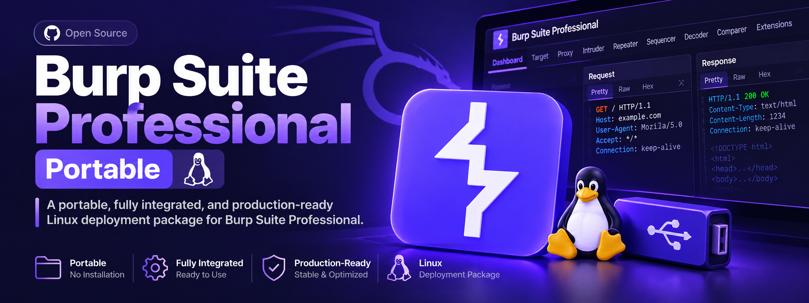

<a id="top"></a>

<div align="center">

  

# Burp Suite Professional Portable
A portable, fully integrated, and production-ready Linux deployment package for Burp Suite Professional.

<br>

[Quick Start](#quick-start) · [Download](#download-archive) · [Installation](#installation) · [Usage](#usage) · [Architecture](#architecture) · [Troubleshooting and FAQ](#troubleshooting-and-faq) · [License](#license)

</div>
<br>

Burp Suite Professional Portable is a self-contained deployment package designed for penetration testers and security researchers on Linux distributions. It delivers automated system integration, dynamic Java runtime paths, window class mapping, and seamless cross-machine installation with zero manual configuration overhead.

---

## Table of Contents
- [Overview](#overview)
- [Why This Project](#why-this-project)
- [Features](#features)
- [Download Archive](#download-archive)
- [Quick Start](#quick-start)
- [Installation](#installation)
- [Configuration](#configuration)
- [Usage](#usage)
- [License Activation Guide](#license-activation-guide)
- [Architecture](#architecture)
- [Compatibility](#compatibility)
- [Troubleshooting and FAQ](#troubleshooting-and-faq)
- [Security](#security)
- [Legal Notice and Responsible Use](#legal-notice-and-responsible-use)
- [Versioning and Changelog](#versioning-and-changelog)
- [License](#license)
- [Maintainers](#maintainers)

---

## Overview

| Attribute | Details |
| :--- | :--- |
| **Status** | Stable |
| **Latest Version** | 2025.9.4 |
| **Primary Language** | Shell, Java |
| **Platforms** | Linux (Ubuntu, Debian, Kali Linux) |
| **Intended Audience** | Penetration testers, security researchers, bug bounty hunters |
| **License** | MIT (for wrapper scripts and integration tooling) |

Burp Suite Professional Portable bridges the gap between manual Java application configuration and native Linux desktop integration. It resolves common operational friction points such as missing taskbar dock grouping, absolute path dependencies, and repetitive JVM argument setups. It deliberately excludes the commercial Burp Suite binary licensing distribution itself, providing only the portable runtime wrappers, automated installers, and desktop configurations.

---

## Why This Project

| Problem | Approach | Outcome |
| :--- | :--- | :--- |
| Manual configuration of Burp Suite Professional on Linux requires repetitive setup of JVM module flags, agent bindings, and environment variables. | Encapsulates runtime logic into dynamic shell scripts (`run.sh`) that resolve paths at execution time. | Eliminates manual command construction and path maintenance across different machines. |
| Linux window managers (GNOME/XFCE) treat raw Java runtime processes as unassigned windows, resulting in generic fallback icons in taskbars. | Enforces explicit window class mapping (`StartupWMClass=burp-StartBurp`) within system desktop entries. | Clean visual integration and permanent dock grouping under the official application icon. |

---

## Features

| Capability | Description |
| :--- | :--- |
| **Dynamic Path Resolution** | Evaluates the runtime directory using BASH source expansion to guarantee absolute portability across arbitrary user accounts and storage media. |
| **Automated System Integration** | Registers `.desktop` shortcuts, updates system icon caches, and configures desktop databases automatically via `install.sh`. |
| **Native Dock Binding** | Maps window identifiers to ensure active application windows anchor cleanly to the official icon in the system taskbar. |
| **Encapsulated JVM Flags** | Pre-configures all mandatory modular access permissions (`--add-opens`) and bytecode verification bypasses required by modern Java runtimes. |

---

## Download Archive

Due to GitHub repository file size limitations (25MB limit for direct web uploads), the full pre-packaged portable distribution archive (`BurpSuitePro_Portable.tar.gz`) is hosted securely on Google Drive:

* **[Download BurpSuitePro_Portable.tar.gz (Google Drive)](YOUR_GOOGLE_DRIVE_LINK_HERE)**

---

## Quick Start

Get a working instance in under five minutes.

```bash
# 1. Download and extract the portable archive
tar -xzvf BurpSuitePro_Portable.tar.gz && cd BurpSuitePro_Portable

# 2. Grant execution permissions and run automated installation
chmod +x run.sh install.sh && ./install.sh

# 3. Launch application
./run.sh

```

Expected result:
Burp Suite Professional graphical interface launches, and the application window binds cleanly to the system dock icon.

> [!NOTE]
> Requires OpenJDK 21 or later. See [Installation](https://www.google.com/search?q=%23installation) for alternative methods and [Compatibility](https://www.google.com/search?q=%23compatibility) for supported environments.

---

## Installation

### From Archive

```bash
tar -xzvf BurpSuitePro_Portable.tar.gz
cd BurpSuitePro_Portable
chmod +x run.sh install.sh
./install.sh

```

### Verify the Installation

```bash
java -version

```

---

## Configuration

Settings and runtime parameters are resolved via the execution script (`run.sh`). No complex configuration files are required for basic operations.

> [!IMPORTANT]
> Never commit sensitive credentials, tokens, or active license keys to shared or public repositories.

---

## Usage

### Basic Usage

Execute the launcher script directly from the terminal or via the application menu:

```bash
./run.sh

```

### Common Workflows

#### Automated System Installation

```bash
./install.sh

```

#### Manual Application Execution

```bash
./run.sh

```

---

## License Activation Guide

To complete the initial one-time activation of Burp Suite Professional using the bundled loader:

1. **Launch the Keygen Loader Interface:**
Open a terminal inside the project directory and execute:
```bash
java -jar burploader.jar

```


2. **Launch Burp Suite Professional:**
Execute the application launcher in parallel:
```bash
./run.sh

```


3. **Complete the Activation Workflow:**
* In the Keygen window, configure options (such as Auto-Reset and Loader) and copy the generated license string.
* Paste the license string into the Burp Suite activation wizard and select **Manual Activation**.
* Copy the **Activation Request** block from Burp Suite and paste it into the Keygen input field.
* Copy the generated **Activation Response** from the Keygen and paste it back into Burp Suite to finalize activation.


---

## Architecture

```flowchart LR
    Client["User / Shell"] --> Launcher["run.sh"]
    Launcher --> Java["OpenJDK 21 Runtime"]
    Java --> Agent["burploader.jar (JavaAgent)"]
    Java --> Core["burpsuite_pro_v2025.9.4.jar"]

```

### Design Principles

* **Portability:** Zero hardcoded absolute paths; runtime directories are resolved dynamically.
* **Isolation:** Encapsulated execution environment independent of global system configurations.
* **Compliance:** Standardized desktop entry registration following freedesktop.org specifications.

---

## Compatibility

| Component | Supported Versions | Notes |
| --- | --- | --- |
| **OpenJDK** | Version 21 | Mandatory for modular access flags and bytecode compatibility |
| **Linux Distributions** | Ubuntu 20.04+, Debian 11+, Kali Linux 2023.x+ | Tested on GNOME and XFCE desktop environments |

---

## Troubleshooting and FAQ

For unresolved problems, search existing issues before opening a new one, and include your distribution version, Java runtime details, and reproduction steps.

---

## Security

> [!WARNING]
> Do not report security vulnerabilities through public issues, discussions, or pull requests.

Report vulnerabilities privately through GitHub Security Advisories or via maintainer contact channels. Include a description, reproduction steps, affected versions, and potential impact.

---

## Legal Notice and Responsible Use

> [!CAUTION]
> This project and its accompanying configuration files are provided strictly for authorized security testing, research, and educational purposes only. Use this software exclusively against systems you own or for which you hold explicit written authorization.
> The authors and contributors assume no liability for misuse, damage, or unlawful activity arising from the use of this software. Users are solely responsible for compliance with all applicable laws and regulations in their jurisdiction.

---

## Versioning and Changelog

This project adheres to Semantic Versioning. Notable changes for every release are recorded in `CHANGELOG.md`, and tagged releases are available on the Releases page.

---

## License

Distributed under the MIT License. See `LICENSE` for more information regarding wrapper scripts and integration tools.

---

## Maintainers

| Name | GitHub | Role |
| --- | --- | --- |
| Bassam Elsopky (HaQtor) | [@belsopky](https://github.com/belsopky) | Author and Maintainer |

[Back to top](https://www.google.com/search?q=%23top)

---

